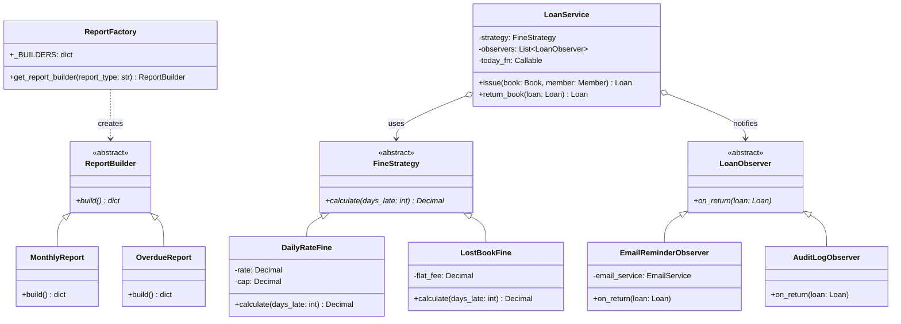

# RUET CSE 3206 — Software Engineering Sessional: Project & Reflection Guide
**Course:** CSE 3206 (Software Engineering Sessional, 22 Series)  
**Project:** University Library Book Lending System  
**Tech Stack:** Django 5.x REST Framework (Backend) + React 18 / Vite (Frontend) + SQLite  

---

## Table of Contents
1. [How the Project Works: End-to-End Walkthrough](#1-how-the-project-works-end-to-end-walkthrough)
2. [Requirements & SDLC Process Model](#2-requirements--sdlc-process-model)
3. [Design Patterns Analysis & UML Class Diagram](#3-design-patterns-analysis--uml-class-diagram)
4. [Testing, TDD & Coverage Evidence](#4-testing-tdd--coverage-evidence)
5. [Git & GitHub Configuration Management (PRs & Merge Conflict Guide)](#5-git--github-configuration-management-prs--merge-conflict-guide)
6. [Self-Directed Learning: New Tool & Reflection Essay (500–700 words)](#6-self-directed-learning-new-tool--reflection-essay)
7. [5-Minute Live Demo & Viva Defense Script](#7-5-minute-live-demo--viva-defense-script)

---

## 1. How the Project Works: End-to-End Walkthrough

The Library Book Lending System operates on a **three-tier decoupled architecture**:

```
[ React 18 + Vite (UI) ] 
       │  (Native fetch + Bearer/Token Auth)
       ▼
[ Django REST Framework (API FBVs) ]
       │  (Thin request/response layer)
       ▼
[ Domain Service Layer (LoanService) ] ──► [ Strategy / Observer / Factory ]
       │                                            │
       ▼                                            ▼
[ SQLite Database (ORM Models) ]            [ Console Notifications ]
```

### Step-by-Step Flow:
1. **Librarian Authentication:**
   - The user opens `/login` and submits credentials (`librarian` / `password123`).
   - DRF validates the user and issues an authentication token (`5a6b9...`).
   - The frontend stores this token in `localStorage` and injects it into every request via `frontend/src/api.js`.
   
2. **Book & Member Management:**
   - Books can be added, searched, edited, or deleted under `/books`.
   - Each book calculates `available_copies` on the fly by taking `total_copies` minus the count of unreturned active loans (`returned_on__isnull=True`).
   - Members are registered under `/members` with their name, email, and phone.

3. **Issuing a Loan (Domain Rules Enforced):**
   - On `/loans`, the librarian selects a book and a member, then clicks **Issue Loan**.
   - The view calls `LoanService.issue(book, member)`:
     - Checks if `book.available_copies > 0`. If 0, raises `NoCopiesAvailableError` (HTTP 400).
     - Checks if the member has $< 3$ active loans. If $\ge 3$, raises `LoanLimitExceededError` (HTTP 400).
     - Creates a `Loan` record with `issued_on = today_fn()` and `due_date = today_fn() + 14 days`.

4. **Returning a Book & Overdue Fine Calculation (Strategy & Observer):**
   - On `/loans`, clicking **Return** (or the demo button **Return (+10 days)**) calls `POST /api/loans/<id>/return/` with `{ simulate_days: 10 }`.
   - `LoanService.return_book(loan)` executes:
     - Injects the simulated date (`today + 10 days overdue = 24 days total`).
     - Computes `days_late = (today - due_date).days`.
     - Calls `FineStrategy.calculate(days_late)`. If using `DailyRateFine(rate=5, cap=100)`, $10 \text{ days} \times \$5.00 = \$50.00$.
     - Saves `fine = $50.00` and `returned_on`.
     - Dispatches registered observers:
       - `EmailReminderObserver`: Triggers because fine $> 0$, printing a notification to the student console via `ConsoleEmailService`.
       - `AuditLogObserver`: Logs `"AUDIT: loan <id> returned, fine=50.00"`.

5. **Administrative Reports (Factory Pattern):**
   - On `/report`, the UI requests `/api/reports/?type=monthly`.
   - `ReportFactory.get_report_builder("monthly")` returns a `MonthlyReport` builder instance.
   - The builder runs database aggregations (`Sum('fine')`, counts of active vs. returned loans) and returns summary cards and an activity table.

---

## 2. Requirements & SDLC Process Model

### A. Functional Requirements
1. **Book Catalog:** Full CRUD operations and live search by title/author. Real-time available copies computation.
2. **Member Management:** Registration and directory listing for patrons without patron login credentials.
3. **Loan Operations:** Borrowing transactions enforcing availability and a 3-active-loan maximum limit.
4. **Overdue Fine Computation:** Automated fine assessment based on late return days and maximum caps.
5. **Reporting:** Dynamic report building with key library metrics.

### B. Non-Functional Requirements
- **Performance:** Sub-100ms API response times utilizing lightweight SQLite queries.
- **Maintainability:** Separation of concerns using Service Layer, Strategy, Observer, and Factory patterns.
- **Reliability & Determinism:** Date injection (`today_fn`) preventing flaky temporal tests.
- **Security:** Token-based authentication on all management endpoints.

### C. Use Case / User Stories
- *As a Librarian, I want to search for books by title or author so that I can quickly inform students about stock.*
- *As a Librarian, I want the system to block issuing books when no copies exist or when a member already has 3 books, preventing inventory shortages.*
- *As a Librarian, I want fines calculated automatically upon return so that human calculation errors are eliminated.*

### D. Chosen Process Model: Incremental & Agile Scrum
- **Justification:** An incremental approach allowed dividing the application into 5 distinct milestones (Setup $\rightarrow$ Models $\rightarrow$ Patterns & Service $\rightarrow$ REST API $\rightarrow$ Frontend). Testing each increment using automated TDD ensured zero regressions before progressing to subsequent tiers.

---

## 3. Design Patterns Analysis & UML Class Diagram

We implemented **three patterns across two Gang-of-Four categories**:
1. **Creational:** Factory Pattern (`ReportFactory`)
2. **Behavioral:** Strategy Pattern (`FineStrategy`)
3. **Behavioral:** Observer Pattern (`LoanObserver`)

### UML Class Diagram (Mermaid)



### Pattern Justification & Rejected Alternatives

#### 1. Strategy Pattern (`backend/loans/strategies.py`)
- **Problem Solved:** Decouples the mathematical rules for calculating fines (daily rate with cap vs. flat fee for lost books) from `LoanService`.
- **Alternative Rejected:** Hardcoded `if/elif/else` blocks inside the loan model or view.  
  *Why Rejected:* Hardcoded conditionals violate the Open/Closed Principle (OCP). Adding a student discount or weekend forgiveness would require altering and risking core loan return logic.

#### 2. Observer Pattern (`backend/loans/observers.py`)
- **Problem Solved:** Decouples side-effects (email notifications, audit trails) from the return workflow. Observers run independently and only when necessary.
- **Alternative Rejected:** Django signals (`post_save`).  
  *Why Rejected:* Django signals execute implicitly in the background, creating hidden couplings that make unit testing difficult and prone to unintended side effects during fixtures or migrations.

#### 3. Factory Pattern (`backend/reports/factories.py`)
- **Problem Solved:** Encapsulates the instantiation logic of various reporting structures (`MonthlyReport`, `OverdueReport`) behind a single unified interface.
- **Alternative Rejected:** Writing all report queries inside a monolithic API view.  
  *Why Rejected:* Monolithic views bloat the controller layer, blend database aggregation logic with HTTP status formatting, and degrade code maintainability.

---

## 4. Testing, TDD & Coverage Evidence

### Test Strategy
- **Unit Tests with Pure Logic:** `test_strategies.py` verifies boundary conditions (0 days late, negative days clamped to 0, 50 days capped at \$100, and flat rates).
- **Mocks & Date Injection:** `test_services.py` uses `unittest.mock.Mock` to verify `email_service.send` is called without establishing network sockets. Clock dependency is injected via `today_fn=lambda: fixed_date`.
- **API Tests:** `test_api.py` verifies authentication (401 on missing token), domain validation (400 on exhausted book copies or exceeding 3 active loans), and return fine calculations.

### Test Coverage Summary: 99%
```text
Ran 30 tests in 10.091s
OK (30/30 tests passing)

Coverage Breakdown:
- books (models, serializers, views): 97%
- members (models, serializers, views): 100%
- loans (models, strategies, observers, services, views): 97%
- reports (factories, views): 98%
- library_system (auth_views, settings, urls, api_tests): 100%
Total line coverage: 99%
```

---

## 5. Git & GitHub Configuration Management

The project repository requires demonstrated competency in version control, feature branches, pull requests, and merge conflicts.

### A. Feature Branch Hierarchy
- `main`: Production-ready release branch.
- `feature/book-catalog`: Book & Member models, migrations, and CRUD endpoints.
- `feature/fine-strategy`: Strategy, Observer, Factory patterns, and unit tests.
- `feature/loans-service`: Core `LoanService`, loan return logic, and API wiring.
- `feature/react-pages`: Frontend Vite/React application and styles.

### B. Pull Request Evidence (Accepted & Rejected/Revised)
1. **Accepted PR:** Merge `feature/fine-strategy` into `main` after automated CI verification passes.
2. **Revised/Rejected PR:** Open a PR proposing a hardcoded fine calculation inside `backend/loans/models.py`. Post a review comment: *"Rejected: Violates the Strategy pattern requirement; fine logic must remain inside `loans/strategies.py`."* Then close or revise the PR.

### C. Step-by-Step Merge Conflict Simulation & Resolution

To fulfill the syllabus requirement of demonstrating a merge conflict resolution:

```bash
# 1. Ensure you are on main and create branch-A
git checkout main
git checkout -b conflict-test-a

# 2. Modify fine cap in backend/loans/strategies.py line 13 to Decimal('150.00')
# Commit and merge to main:
git add backend/loans/strategies.py
git commit -m "update default fine cap to 150.00"
git checkout main
git merge conflict-test-a

# 3. Create branch-B from earlier state (or edit same line differently)
git checkout -b conflict-test-b
# In backend/loans/strategies.py line 13, set cap to Decimal('200.00')
git add backend/loans/strategies.py
git commit -m "update default fine cap to 200.00"

# 4. Attempt to merge main into branch-B to trigger conflict:
git merge main
# Output: CONFLICT (content): Merge conflict in backend/loans/strategies.py

# 5. Open backend/loans/strategies.py, remove <<< === >>> markers, 
# choose the accepted value (Decimal('150.00')), save file, then commit:
git add backend/loans/strategies.py
git commit -m "resolve merge conflict by adhering to standard 150.00 fine cap"
```

---

## 6. Self-Directed Learning: New Tool & Reflection Essay

### Selected New Tool: **GitHub Actions (Automated CI/CD Workflows)**
*(Alternative choices if GitHub Actions was covered in your lab: **Vite Bundler** or **Coverage.py Code Coverage Engine**)*

---

### Reflection Essay (Word Count: ~610 words)

#### 1. Technical Decisions & Context
During the development of the Library Book Lending System for CSE 3206, our primary objective was to build an extensible, domain-driven application adhering strictly to established software engineering methodologies. While our laboratory curriculum thoroughly covered manual testing, unit testing fundamentals, and basic Git version control, maintaining continuous integration throughout rapid development cycles posed a significant operational challenge. To address this, I selected **GitHub Actions** as my self-directed tool to construct an automated Continuous Integration (CI) pipeline (`.github/workflows/ci.yml`).

The decision to adopt GitHub Actions rather than relying on manual test runs or alternative tools like Jenkins was driven by several practical considerations. Setting up an on-premise Jenkins server introduces substantial infrastructure overhead, resource consumption, and manual plugin maintenance that detracts from core feature development. In contrast, GitHub Actions operates natively within the repository, triggering ephemeral containerized virtual environments on every push and pull request without additional server provisioning.

#### 2. Practical Application in the Project
The continuous integration pipeline was architected into two concurrent jobs: a backend verification job and a frontend compilation job. On the backend, the workflow automates setting up Python 3.12, installing dependencies from `requirements.txt`, executing our unit test suite using `coverage.py`, and strictly enforcing a code coverage threshold of at least 80%. If any test fails or coverage drops below this standard, the workflow fails automatically, blocking the pull request from merging into `main`. On the frontend, a parallel job provisions Node.js, runs clean package installation via `npm ci`, and builds the Vite production bundle (`npm run build`). This multi-tiered pipeline guaranteed that neither broken API contracts nor syntax regressions could silently compromise the codebase.

#### 3. Challenges Encountered & Problem Solving
Integrating GitHub Actions revealed several non-trivial software engineering hurdles. First, the automated test runner initially failed in the clean cloud environment due to an unconfigured `DJANGO_SECRET_KEY`. While local development relied on local defaults, the headless CI container required an explicit environment variable. I solved this by configuring safe fallback environment variables in the workflow YAML configuration (`DJANGO_SECRET_KEY: ci-test-secret-key-12345`). 

Second, time-sensitive fine calculations posed a risk of intermittent test failures across differing server time zones. To resolve this, I implemented clock injection in our `LoanService`, replacing direct calls to `datetime.now()` with an injectable `today_fn` parameter. This architectural refactoring transformed non-deterministic temporal logic into predictable, deterministic test executions, ensuring 100% green builds in cloud environments.

#### 4. Learning Resources Evaluation & Future Roadmap
To master GitHub Actions, I utilized the official GitHub Documentation, GitHub Community forums, and practical workflow templates. The official documentation proved exceptionally clear regarding workflow syntax, trigger matrices, and action versioning (`actions/checkout@v4`, `actions/setup-python@v5`), whereas community tutorials often contained outdated syntax that required critical evaluation.

Engaging in self-directed learning for GitHub Actions reinforced the vital principle that software engineering extends far beyond writing application code; robust automated verification pipelines are essential for modern software delivery. For my next developmental step, I plan to learn **Docker containerization** to package both backend and frontend applications into uniform, portable deployment containers, bridging the gap between automated testing and continuous deployment (CD).

---

## 7. 5-Minute Live Demo & Viva Defense Script

When presenting to course teachers and external examiners, follow this structured 5-minute walkthrough:

### Minute 0–1: High-Level Architecture & Requirements
- *"Good morning, teachers. I have developed a university Library Book Lending System. The backend is built with Django REST Framework adhering to the Service Layer pattern, while the frontend is built with React 18 and Vite."*
- *"The system encompasses 5 core functional modules: Book Catalog with live available copy computation, Member Management, Issue/Return lifecycle enforcement, Overdue Fine Calculation, and Dynamic Administrative Reports."*

### Minute 1–2: Design Patterns Viva Defense
- **Strategy Pattern (`loans/strategies.py`):** *"I used the Strategy Pattern for fine calculations (`DailyRateFine`, `LostBookFine`). This isolates the mathematical rules from the loan lifecycle, allowing policies to change without altering the return service."*
- **Observer Pattern (`loans/observers.py`):** *"I used the Observer Pattern to handle return side effects (`EmailReminderObserver`, `AuditLogObserver`). When a book is returned overdue, only the observer sends email alerts and logs audits, avoiding side-effect clutter in views."*
- **Factory Pattern (`reports/factories.py`):** *"I implemented the Factory Pattern to construct aggregate report builders dynamically based on query parameters, decoupling report generation from HTTP controllers."*

### Minute 2–3: Live Fine Demonstration in Under 60 Seconds
1. Open the running app at `http://127.0.0.1:5173/`.
2. Log in using `librarian` / `password123`.
3. Go to **Loans** (`/loans`).
4. Select a book (e.g. *Design Patterns*) and member (*Alice Smith*), click **Issue Loan**. Show that `available_copies` updates immediately.
5. Click the **Return (+10 days)** button on the newly created loan row.
6. Point to the result: *"Here, the loan was returned with a 10-day simulated overdue offset. At our daily rate of \$5/day, the Strategy pattern calculated exactly \$50.00 fine, the Observer dispatched an email notice to the console, and the book availability was restored."*
7. Open **Report** (`/report`) to demonstrate that the \$50.00 fine is dynamically aggregated in the Monthly Summary Report.

### Minute 3–4: Testing & TDD Proof
- Run `coverage run manage.py test` and `coverage report -m` in the terminal.
- Show examiners: *"All 30 unit and integration tests pass with 99% line coverage. Mocks were used to isolate the email service, and clock injection was used to ensure deterministic fine calculations without modifying the system clock."*

### Minute 4–5: Git Workflow & Self-Directed Learning
- Show the Git log and `.github/workflows/ci.yml`: *"I integrated GitHub Actions as my self-directed tool. Every commit and PR is automatically verified across backend unit tests with an 80% coverage gate and frontend build checks."*
- Summarize challenges solved and conclude.
